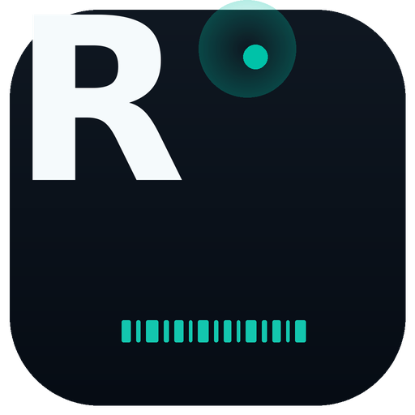
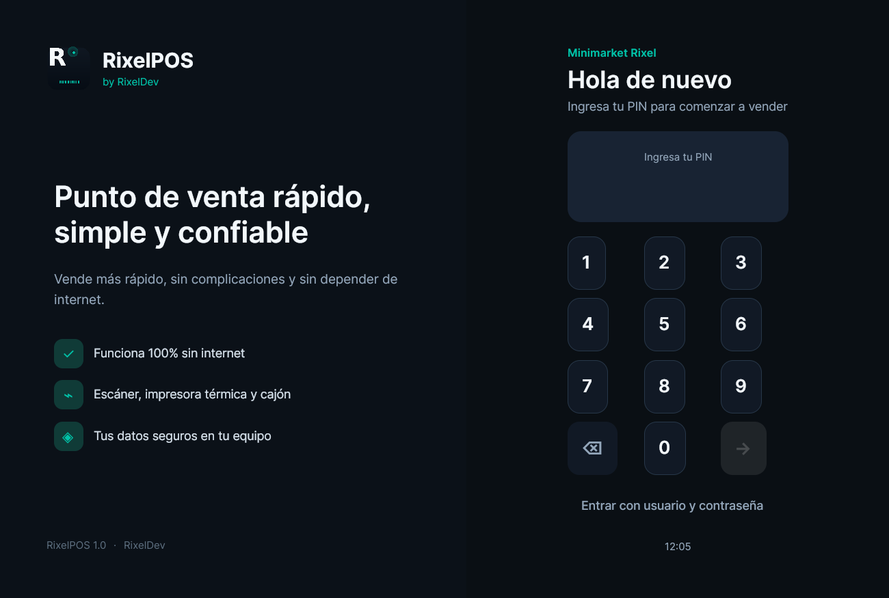
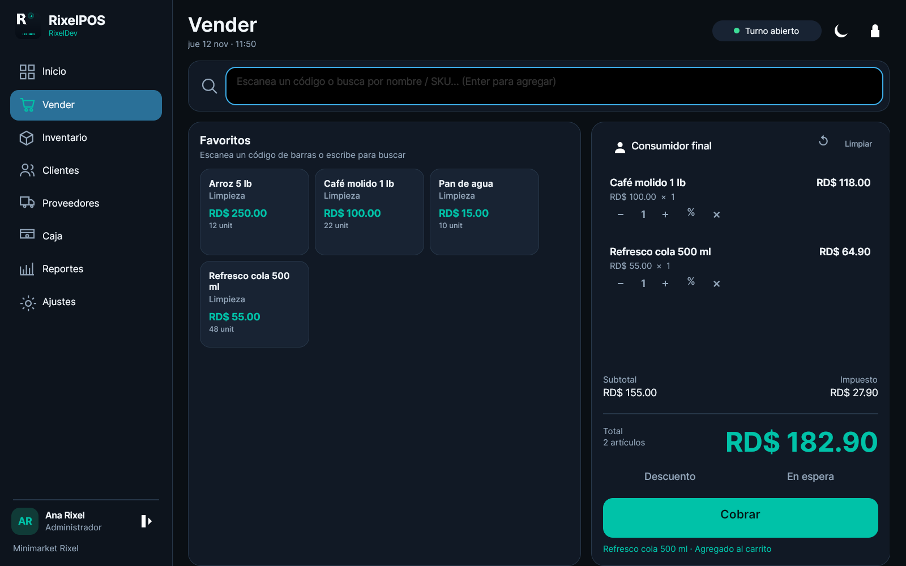
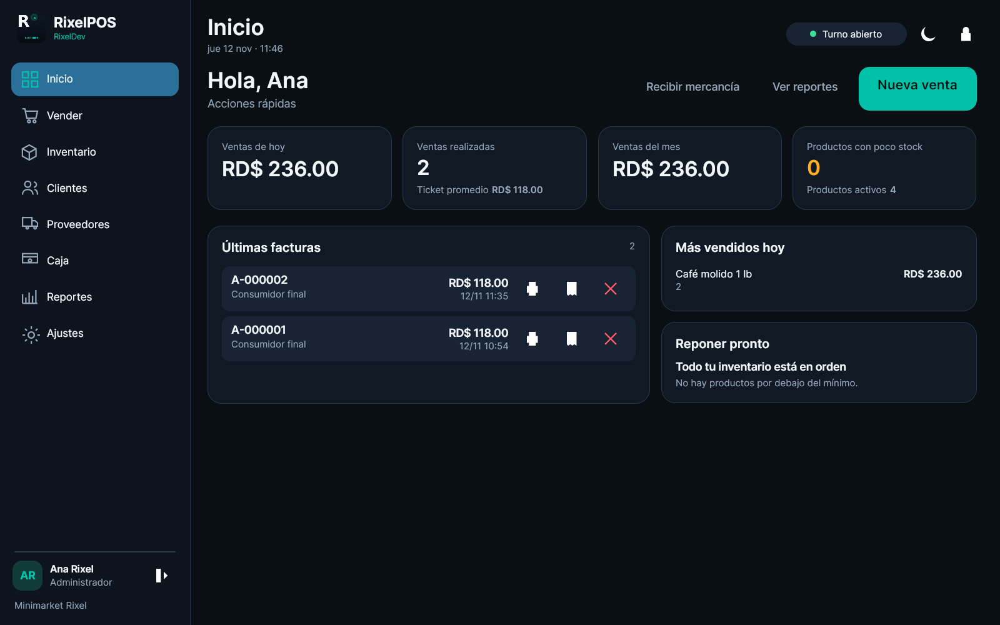
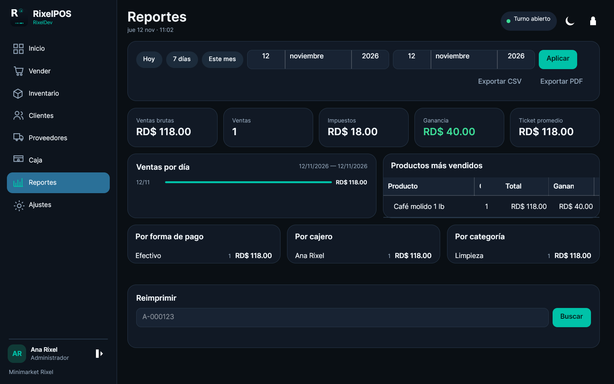

# RixelPOS

**Punto de venta y facturación para pequeños y medianos negocios.**
Una aplicación de escritorio nativa de **RixelDev**, offline-first, para Linux y Windows.

> **RixelPOS** — Rápido, simple y confiable.
> Alternativas de nombre evaluadas: **RixelPOS** (elegido), **RixelBill**, **RixelCaja**.



### Capturas

| Inicio de sesión | Vender |
| --- | --- |
|  |  |

| Inventario | Reportes |
| --- | --- |
|  |  |

Más capturas en [docs/SCREENSHOTS.md](docs/SCREENSHOTS.md).

---

## 1. Decisión tecnológica

Requisitos que mandaron la decisión: aplicación de escritorio real (sin webview, sin
Electron/Tauri, sin navegador), mismo código para Linux y Windows, acceso a hardware
(impresoras ESC/POS por USB/serial/red, cajón, escáner), base de datos local transaccional,
empaquetado con instaladores y mantenibilidad a largo plazo.

| Opción | Ventajas | Riesgos para este proyecto | Resultado |
| --- | --- | --- | --- |
| **C# / .NET 8 + Avalonia UI** | UI nativa multiplataforma (Skia, no webview), MVVM maduro, un solo binario para Linux/Windows, gran ecosistema para serial/TCP/impresión, `dotnet publish` self-contained, pruebas xUnit sencillas | El equipo debe conocer C# | **Elegida** |
| Python + PySide6 | Desarrollo rápido, Qt maduro, buenas librerías | Empaquetado pesado y frágil en Windows/Linux, arranque más lento, tipado y refactorización más débiles | Descartada |
| C++ + Qt 6 | Máximo rendimiento y aspecto nativo | Más tiempo de desarrollo, gestión manual de memoria y de dependencias, instaladores más complejos | Descartada |
| Rust + Slint / iced | Binarios pequeños y rápidos | Ecosistema de UI/impresión y madurez de widgets aún limitados para un POS completo | Descartada |
| Flutter Desktop / Go + Fyne | Multiplataforma y UI moderna | Flutter arrastra una capa gráfica pesada y el soporte de impresión térmica es indirecto; Fyne no tiene la madurez de un POS | Descartadas |
| Electron / Tauri + React | UI rápida de escribir | **Excluido explícitamente** por el requisito de app nativa sin webview | Excluida |

**Justificación final:** .NET 8 es LTS, Avalonia 11 ofrece una UI nativa real con un solo
proyecto para Linux y Windows, y el stack permite separar dominio, aplicación,
infraestructura y UI con pruebas automatizadas. El mismo ejecutable se publica como
self-contained para no depender de un runtime instalado en la caja.

---

## 2. Lo que incluye esta versión

### Ventas
- Pantalla única de cobro: buscador siempre enfocado, favoritos táctiles, carrito grande y total visible.
- Escáner en modo **keyboard-wedge** (sin configuración) y escáner **serial** opcional.
- Búsqueda por nombre, SKU o código de barras con autocompletado.
- El precio que registras **ya incluye impuesto**: es exactamente lo que paga el cliente.
- Sin tasa de impuesto por defecto: si no configuras una, el total es el precio tal cual.
- Al escanear o escribir un código exacto, el artículo se agrega automáticamente.
- Vista previa del comprobante antes de imprimir, con impresión o PDF desde la misma ventana.
  `Enter` imprime y cierra; la venta completada no bloquea la caja y se cierra al escanear
  el siguiente producto.
- Bloqueo automático por inactividad con PIN del usuario actual.
- Atajos de teclado completos y ayuda con F12; SKU automático a partir del nombre y el código.
- Cantidades, descuentos por línea y por venta (porcentaje o monto fijo), eliminación de líneas.
- Ventas en espera y reanudación.
- Pago en efectivo con cambio automático, tarjeta, transferencia, crédito a favor y venta a crédito.
- Pagos mixtos y validaciones de límite de crédito / crédito a favor.
- Atajos: `F1`–`F8` para navegar, `Enter` para agregar/cobrar, `Esc` para limpiar, `Ctrl+L` para cerrar sesión.
- Anulación de ventas con restauración de stock y aprobación de encargado cuando aplica.

### Facturación
- Recibos térmicos **58 mm y 80 mm** con logo, datos del negocio, QR, código de barras de factura y corte.
- Factura **A4 en PDF** (SkiaSharp) con tabla de líneas, impuestos, pagos y QR.
- Numeración secuencial configurable (`A-000123`), prefijo y padding.
- Reimpresión de recibos desde el inicio y el historial de clientes; búsqueda de factura por número.
- Impuesto configurable (ITBIS/IVA/VAT); por defecto los precios ya lo incluyen.
- Capa fiscal enchufable. Módulo opcional **NCF (República Dominicana)**; el núcleo no depende de él.

### Inventario
- Productos con SKU, múltiples códigos de barras, categoría, costo, precio, impuesto, stock, mínimo, unidad, favoritos e imagen.
- **Recepción por escaneo**: si el código existe suma cantidad; si es nuevo abre el formulario con el código precargado.
- **Lote de recepción** con resumen y confirmación transaccional.
- **Conteo físico**: escanea, compara contra el sistema, muestra diferencias y aplica ajustes.
- Ajustes manuales con motivo y bitácora de movimientos.
- Códigos internos EAN-13 y etiquetas por impresora térmica.
- Importación/exportación CSV compatible con Excel/LibreOffice y plantilla descargable.
- Alertas de bajo stock y agotados.

### Clientes y proveedores
- Clientes con teléfono, RNC, dirección, límite de crédito, balance y crédito a favor.
- Historial de compras, abonos, carga de crédito y reimpresión.
- Proveedores y órdenes de compra; recepción que actualiza stock y costo.

### Caja
- Apertura y cierre de turno con fondo inicial.
- Entradas/salidas de efectivo con motivo.
- Totales por forma de pago y **reporte Z** de cierre.
- Historial de turnos y consulta de reportes Z.

### Reportes
- Ventas por día, producto, categoría, cajero y forma de pago.
- Ganancia (precio – impuesto – costo), ticket promedio y exportación **CSV** y **PDF**.
- Búsqueda de factura para reimpresión.

### Seguridad y administración
- Roles **Administrador**, **Encargado** y **Cajero** con permisos.
- Login rápido por PIN y login por usuario/contraseña; bcrypt.
- Aprobación de encargado para anular, devolver o aplicar descuentos altos.
- Bitácora de auditoría de acciones sensibles.
- Ajustes de negocio, impuestos, facturación fiscal, recibos, hardware, usuarios, respaldos, tema e idioma.
- Instancia única por carpeta de datos y validación de integridad al restaurar respaldos.
- “Acerca de” con sitio web, correo de soporte copiable y licencia de uso.
- Los productos archivados liberan su SKU y sus códigos de barras para poder recrearlos.
- Copias de seguridad locales automáticas/manuales, restauración y retención configurable.

### Experiencia
- Diseño oscuro/claro consistente, tipografía Inter, botones grandes y alto contraste.
- Asistente de primera ejecución, onboarding de 3 pasos, estados vacíos y mensajes de error accionables.
- Español e inglés (cambio de idioma al reiniciar).
- Sonidos distintos para escaneo encontrado / nuevo / error.

---

## 3. Arquitectura

```
RixelPOS.sln
├── src/
│   ├── RixelPOS.Domain/          # Entidades, Money, Discount, SaleCalculator, reglas puras
│   ├── RixelPOS.Application/     # Casos de uso, carrito, checkout, inventario, reportes,
│   │                             # fiscal, abstracciones de persistencia/hardware
│   ├── RixelPOS.Infrastructure/  # SQLite + Dapper + migraciones, ESC/POS, PDF, bcrypt,
│   │                             # backups, logging, descubrimiento de dispositivos
│   └── RixelPOS.Desktop/         # Avalonia UI, MVVM, i18n, tema, ventanas y diálogos
├── tests/
│   ├── RixelPOS.Domain.Tests/        # matemática de ventas, impuestos, descuentos, EAN-13
│   └── RixelPOS.Infrastructure.Tests/# SQLite, ventas completas, caja, reportes, PDF, backup
├── packaging/
│   ├── windows/                  # build.ps1 + installer.iss (Inno Setup)
│   └── linux/                    # build.sh (AppImage/deb/tar), PKGBUILD, .desktop, udev
├── docs/
│   ├── ARCHITECTURE.md
│   ├── HARDWARE.md
│   ├── USER_GUIDE.md
│   ├── DEVELOPMENT.md
│   └── RixelPOS_prompt.md
├── .github/workflows/ci.yml
├── Directory.Build.props
├── global.json
└── README.md
```

### Capas
- **Domain**: no depende de nadie. `Money` usa **centavos enteros**; nunca `float` para dinero.
  `SaleCalculator` calcula descuentos, impuestos inclusivos/exclusivos y reparte descuentos
  de venta con el método del mayor residuo para que los totales siempre cuadren.
- **Application**: orquesta casos de uso a través de `IPosStore` y de interfaces de hardware.
  `CheckoutService.CompleteSale` ejecuta toda la venta dentro de una transacción: número de
  venta, factura, líneas, pagos, descuento de stock, crédito del cliente y auditoría.
- **Infrastructure**: implementa `IPosStore` con Microsoft.Data.Sqlite + Dapper, migraciones
  embebidas, WAL, `busy_timeout`, `VACUUM INTO` para respaldos, transporte ESC/POS y PDF.
- **Desktop**: Avalonia + CommunityToolkit.Mvvm. Es la única capa que conoce ventanas.

### Flujo de una venta
1. El cajero escanea; el producto se agrega al `Cart`.
2. `SaleCalculator` recalcula en cada cambio.
3. Al cobrar, `CheckoutService` valida caja abierta, stock, pagos, límites y permisos.
4. En una transacción SQLite se inserta la venta, se asigna el consecutivo, se emite la
   factura, se descuenta stock y se ajusta el crédito del cliente.
5. Se imprime el recibo y se muestra el cambio. Si se corta la luz, SQLite/WAL garantiza
   que la venta quede completa o no quede.

### Base de datos
SQLite local, WAL, foreign keys, migraciones en `src/RixelPOS.Infrastructure/Data/Migrations`.
Tablas principales: `products`, `product_barcodes`, `categories`, `tax_rates`, `sales`,
`sale_lines`, `payments`, `invoices`, `customers`, `suppliers`, `purchase_orders`,
`purchase_order_lines`, `cash_sessions`, `cash_movements`, `stock_movements`,
`stock_counts`, `stock_count_lines`, `users`, `audit_log`, `settings`, `sequences`.
El detalle y los índices están en [docs/ARCHITECTURE.md](docs/ARCHITECTURE.md).

### Sincronización futura
El diseño permite añadir un módulo de sincronización sin reescribir la caja. La propuesta:
un terminal principal expone una API local (LAN) y las cajas secundarias encolan eventos
idempotentes (ventas, movimientos, ajustes) con un `outbox` SQLite. Un servidor de
sincronización opcional replica a la nube. El modo actual es 100% local y no requiere red.

---

## 4. Descargas e instalación

El workflow `.github/workflows/release.yml` publica automáticamente Linux y Windows en
cada actualización de `main` (release **latest**) y en cada tag `v*` (release versionada).
Descarga desde:

**https://github.com/rixeldev/rixelpos/releases/latest**

| Sistema | Instalación |
| --- | --- |
| CachyOS / Arch | Repositorio pacman: añade `[rixelpos]` (ver abajo) y `sudo pacman -S rixelpos` |
| Arch directo | `sudo pacman -U rixelpos-<version>-1-x86_64.pkg.tar.zst` |
| AppImage | `chmod +x RixelPOS-<version>-x86_64.AppImage && ./RixelPOS-<version>-x86_64.AppImage` |
| .deb | `sudo apt install ./rixelpos_<version>_amd64.deb` |
| Portable Linux | `tar -xzf rixelpos-<version>-linux-x64.tar.gz && ./install.sh` |
| Windows | `RixelPOS-Setup-<version>.exe` (o el ZIP portable) |

Repositorio pacman (rama `gh-pages`, habilitar Pages en el repositorio):

```ini
[rixelpos]
SigLevel = Optional TrustAll
Server = https://rixeldev.github.io/rixelpos/pacman/$arch
```

```bash
sudo pacman -Syu
sudo pacman -S rixelpos
```

**La app es self-contained: no necesita .NET instalado.** Para desarrollo o si quieres el
SDK, el instalador de Windows marca por defecto la tarea “Instalar .NET SDK 8 si falta” (desmarcable), y
Linux incluye `rixelpos-install-dotnet` (`packaging/prerequisites/install-dotnet.sh`).
También puedes descargar el SDK manualmente. Ver [docs/RELEASES.md](docs/RELEASES.md).

### Requisitos de desarrollo
- .NET SDK 8.0 (probado también con SDK 10 usando `rollForward`).
- En Linux: dependencias de Avalonia (X11/Wayland, fuentes, ICU).
- En Windows: Windows 10/11.

```bash
git clone git@github.com:rixeldev/rixelpos.git
cd rixelpos
dotnet restore RixelPOS.sln
dotnet build RixelPOS.sln -c Release
dotnet test RixelPOS.sln -c Release
dotnet run --project src/RixelPOS.Desktop
```

La app usa `RIXELPOS_DATA_DIR` si está definido; si no:

| SO | Carpeta de datos |
| --- | --- |
| Linux | `~/.local/share/rixelpos/` |
| Windows | `%APPDATA%\rixelpos\` |

Dentro: `rixelpos.db`, `backups/`, `logs/`, `documents/`.

### CachyOS / Arch Linux (desarrollo)
```bash
sudo pacman -S dotnet-sdk icu fontconfig libx11 libice libsm libxrandr libxi \
  libxcursor libxrender mesa libglvnd
dotnet run --project src/RixelPOS.Desktop
```
Si usas una impresora USB directa o serial:
```bash
sudo usermod -aG lp $USER      # cierra sesión y vuelve a entrar
sudo udevadm control --reload-rules
```
Ver [docs/HARDWARE.md](docs/HARDWARE.md) para reglas udev, CUPS y raw printing.

### Windows 10/11 (desarrollo)
```powershell
dotnet run --project src\RixelPOS.Desktop
```
Para imprimir necesitas la impresora instalada en Windows. RixelPOS envía trabajos
**RAW** al spooler usando el nombre exacto de la impresora.

---

## 5. Empaquetado

### Linux (CachyOS / Arch)
```bash
chmod +x packaging/linux/build.sh
./packaging/linux/build.sh 1.0.0
```
Genera:
- `dist/linux/RixelPOS-x86_64.AppImage` (si `appimagetool` está disponible),
- `dist/linux/rixelpos_1.0.0_amd64.deb` (si `dpkg-deb` está disponible),
- `dist/linux/rixelpos-1.0.0-linux-x64.tar.gz`,
- `dist/linux/rixelpos-1.0.0-1-x86_64.pkg.tar.zst`,
- `dist/linux/pacman/x86_64/` con `rixelpos.db` listo para `pacman -S`,
- `dist/linux/PKGBUILD` listo para AUR (ajusta el `source` a tu release).

`packaging/linux/PKGBUILD` también se puede copiar a un directorio y ejecutar:
```bash
makepkg -si
```

### Windows
```powershell
powershell -ExecutionPolicy Bypass -File packaging\windows\build.ps1 -Version 1.0.0
```
Genera:
- `dist/windows/RixelPOS-1.0.0-win-x64.zip` (portable),
- `dist/windows/RixelPOS-Setup-1.0.0.exe` si Inno Setup 6 (`iscc`) está instalado.

Firma recomendada (no se incluye ningún certificado en el repo):
```powershell
signtool sign /fd SHA256 /tr http://timestamp.digicert.com /td SHA256 `
  /f $env:CERT_PATH /p $env:CERT_PASSWORD dist\windows\RixelPOS-Setup-1.0.0.exe
```

### Autoactualización
El ejecutable es self-contained. La actualización recomendada es descargar el instalador
firmado de la última release y ejecutarlo por encima (Windows) o reemplazar el AppImage
(Linux). Un futuro módulo `UpdateService` puede verificar una URL de releases firmadas y
mostrar un aviso; no se implementó una autoactualización silenciosa para no comprometer la
caja sin consentimiento.

---

## 6. Uso diario (resumen)

1. **Primer inicio**: asistente de negocio, moneda/impuestos, impresora y administrador.
2. **Abrir caja**: menú **Caja** → **Abrir caja** con el fondo inicial.
3. **Vender**: `F2`, escanear o buscar, revisar el carrito, `Enter`/**Cobrar**, elegir pago,
   confirmar e imprimir.
4. **Recibir mercancía**: `F3` → **Recibir mercancía**, escanear, confirmar el lote.
5. **Conteo físico**: `F3` → **Conteo físico**, escanear y finalizar.
6. **Reportes**: `F6`; exportar CSV/PDF.
7. **Cerrar caja**: **Caja** → **Cerrar caja**, contar efectivo, revisar el reporte Z.

Guía completa: [docs/USER_GUIDE.md](docs/USER_GUIDE.md).

---

## 7. Hardware

Resumen de conexiones admitidas:

| Dispositivo | Conexión | Ejemplo |
| --- | --- | --- |
| Escáner USB | Teclado (wedge) | Sin configuración |
| Escáner serial | `serial:` | `serial:/dev/ttyUSB0@9600`, `serial:COM3@9600` |
| Impresora térmica | Red TCP | `tcp://192.168.1.50:9100` |
| Impresora térmica | USB Windows | `usb:EPSON TM-T20III` |
| Impresora térmica | CUPS Linux | `cups:EPSON_TM_T20III` |
| Impresora térmica | Serial | `serial:/dev/ttyUSB0@19200` |
| Impresora térmica | Archivo (pruebas) | `file:/tmp/rixelpos.bin` |
| Cajón | Pulso ESC/POS | Se abre con el recibo |
| Pantalla cliente | Serial | `serial:/dev/ttyUSB1@9600` (opcional) |

Cada configuración tiene **Detectar**, **Probar impresora** y **Probar cajón** en
**Ajustes → Recibos**. Los errores se muestran como mensajes humanos, nunca stack traces.

Detalle completo: [docs/HARDWARE.md](docs/HARDWARE.md).

---

## 8. Pruebas y CI

```bash
dotnet test RixelPOS.sln
```
Cobertura actual:
- matemática de dinero, impuestos inclusivos/exclusivos, descuentos y reparto exacto,
- numeración de facturas y EAN-13,
- integración SQLite: productos, ventas, stock, crédito, caja, reportes, backup,
- generación de PDF y flujo ESC/POS,
- bcrypt + aprobación de encargado.

CI en `.github/workflows/ci.yml` compila y prueba en `ubuntu-latest` y `windows-latest`
y publica artefactos self-contained de cada plataforma.

---

## 9. Seguridad y datos

- Todo se guarda localmente; la app funciona sin internet.
- Contraseñas/PIN con bcrypt; nunca en texto plano.
- SQLite con WAL y transacciones por venta.
- Respaldos automáticos al cerrar (configurable) y manuales; restauración con respaldo de
  seguridad previo.
- No hay secretos en el repositorio. `.gitignore` excluye bases reales, logs, respaldos y
  material de firma. Ver [SECURITY.md](SECURITY.md).

---

## 10. Supuestos y límites conocidos

- Idioma por defecto: **español (es-DO)**; inglés incluido. El cambio de idioma se aplica al
  reiniciar (los textos están compilados en la vista para evitar bindings frágiles).
- El módulo fiscal NCF está implementado como generador de NCF y datos fiscales; la firma
  electrónica y el envío a DGII quedan como extensión del proveedor fiscal.
- Los pagos con tarjeta no integran una pasarela: se registran como método de pago.
- Las ventas a crédito y el crédito a favor deben activarse en Ajustes.
- La sincronización multterminal está diseñada pero no implementada en esta versión.
- El PDF A4 usa la fuente del sistema para el texto y SkiaSharp para el render.
- El empaquetado Windows no incluye un certificado de firma (no se deben subir secretos).

---

## 11. Agentes y mantenimiento

- Lee y actualiza [AGENTS.md](AGENTS.md): contiene reglas de arquitectura, UI/DPI,
  pruebas, releases y seguridad para cualquier agente que trabaje en el proyecto.
- Antes de un cambio grande: `dotnet build` + `dotnet test`; después, actualiza docs y
  AGENTS si cambia la estructura o el empaquetado.
- El repositorio se mantiene privado y sin secretos; ver `.gitignore` y `SECURITY.md`.
- **Política de publicación:** tras un lote de cambios importantes, el agente sube la
  versión en `Directory.Build.props`, hace commit, `git push origin main` y publica el tag
  `vX.Y.Z`. Esto genera la release `latest` y la versionada con todos los artefactos.

## 12. Licencia

Software propietario de **RixelDev**. Ver [LICENSE](LICENSE).

Hecho con cariño para que cobrar sea lo más simple del día.

---

## 13. Repositorio y manejo de secretos

- Repositorio remoto: `git@github.com:rixeldev/rixelpos.git` (privado).
- `bin/`, `obj/`, `dist/`, bases de datos, respaldos, logs y material de firma están
  excluidos por `.gitignore`.
- No hay contraseñas, tokens, claves de API ni certificados en el código.
- `SECURITY.md` describe cómo reportar vulnerabilidades.
- `.github/dependabot.yml` mantiene NuGet y GitHub Actions al día.
- La CI no requiere secretos para compilar y probar. La firma y publicación de releases
  deben usar secretos del entorno de GitHub, nunca el repositorio.

